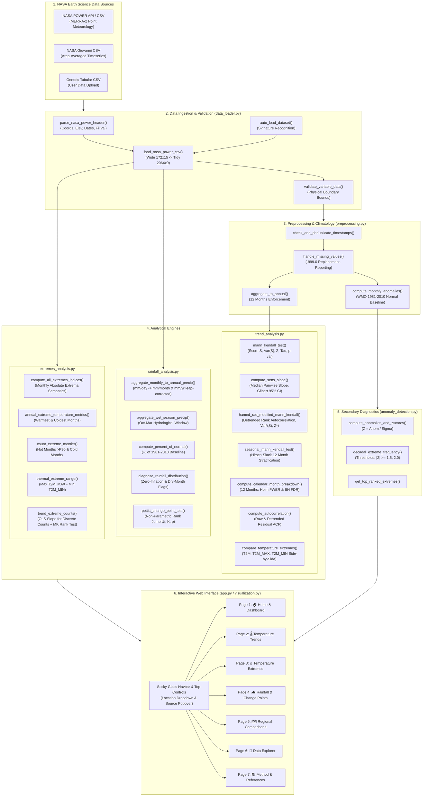

# Team Handover Guide & Collaborative Architecture
**Project**: EarthTrend Explorer (NASA Space Apps Challenge 2026: *"Be An Earth System Trend Detective!"*)  
**Team**: Machine Without Learning  
**Development Stage**: **Active Collaborative Development** (Ongoing — NOT Finalized)  
**Workspace**: `D:\Space-Apps`  
**Git Branch**: `feature/rainfall-analysis` (tracking `origin/feature/rainfall-analysis`)  
**Remote Git Repository**: `https://github.com/ammarsami255/Be-An-Earth-System-Trend-Detective.git`  

---

## A. Project Overview

### 1. What is the Project?
`EarthTrend Explorer` is an interactive scientific web application engineered to analyze multi-decadal environmental trends using authentic NASA Earth Science data. Developed for the NASA Space Apps Challenge 2026 challenge *"Be An Earth System Trend Detective!"*, the application provides an open-source, reproducible data-science workbench that moves beyond static infographics to deliver rigorous statistical inference.

### 2. What Problem Are We Solving?
Climate and environmental dashboards often fall into two opposite extremes:
- Overly simplistic visual dashboards that display linear trendlines without testing for statistical significance, ignoring temporal autocorrelation, seasonality, and multiple testing false alarms.
- Dense, inaccessible academic command-line scripts that cannot be explored interactively by researchers, students, or decision-makers.

`EarthTrend Explorer` bridges this gap by directly answering the four scientific questions posed by the challenge:
1. **What is changing?** (Trajectory of mean temperature, absolute temperature extremes, accumulated precipitation, wet-season precipitation).
2. **Where is it changing?** (Explicit coordinates and native MERRA-2 atmospheric model grid cells across Greater Cairo, Alexandria, and Aswan).
3. **How much is it changing?** (Robust decadal rates via Theil-Sen estimators, cumulative change over elapsed years, Percent of Normal baseline shifts).
4. **Is the observed trend statistically significant?** (Mann-Kendall test, Hamed-Rao serial correlation correction, False Discovery Rate control, and Pettitt non-parametric abrupt change-point detection).

### 3. Current Development Stage
**The project is actively under development.** The core non-parametric statistical engines, data loaders, anomaly detection routines, rainfall accumulator, temperature extremes module, Pettitt change-point test, Standardized Precipitation Index (SPI) drought engine, and a responsive glass navbar Streamlit interface are implemented and verified with **52 automated unit and integration tests (100% pass rate)**. The next development phase focuses on satellite cross-validation against NASA GPM IMERG, multivariate slope interaction tests, and gridded NetCDF spatial mapping.

---

## B. System Architecture

### 1. High-Level Data Flow Pipeline


---

## C. Module Breakdown

### 1. `src/data_loader.py`
- **Responsibility**: Ingestion, header parsing, coordinate mapping, and tidy formatting of NASA POWER exports, Giovanni exports, and generic CSVs.
- **Key Functions**:
  - `parse_nasa_power_header(content)`: Extracts coordinate metadata, elevation, fill value.
  - `load_nasa_power_csv(content)`: Converts wide ($172 \times 15$) tables into tidy ($2064 \times 9$) DataFrames.
  - `auto_load_dataset(content)`: Intelligent format classifier.
  - `fetch_nasa_power_point(lat, lon, start, end)`: Live API query to NASA POWER.
  - `validate_variable_data(df, variable_name)`: Physical range validator.
- **Input / Output**: Raw CSV strings $\to$ Standardized tidy pandas DataFrames (`date`, `year`, `month`, `month_name`, `variable`, `value`, `units`, `location`, `is_missing`).
- **Dependencies**: `pandas`, `numpy`, `requests`, `re`.

### 2. `src/preprocessing.py`
- **Responsibility**: Transparent data cleansing, temporal aggregation, deduplication, and baseline climatology.
- **Key Functions**:
  - `check_and_deduplicate_timestamps()`: Duplicate detection and resolution.
  - `handle_missing_values()`: Replaces NASA fill values (`-999.0`) with `np.nan` and generates audit reports.
  - `aggregate_to_annual()`: Aggregates 12 monthly observations to annual means, enforcing `min_months=12`.
  - `compute_monthly_anomalies()`: Calculates WMO 1981–2010 climatological monthly normals and anomalies.
- **Dependencies**: `pandas`, `numpy`.

### 3. `src/trend_analysis.py`
- **Responsibility**: Non-parametric trend statistics, confidence intervals, serial correlation corrections, multiple testing error control, and regional comparison.
- **Key Functions**:
  - `mann_kendall_test()`: Standard Mann-Kendall test ($S, \text{Var}(S), Z, p, \tau$).
  - `compute_sens_slope()`: Theil-Sen median slope with Gilbert (1987) analytical 95% confidence intervals.
  - `hamed_rao_modified_mann_kendall()`: Autocorrelation-corrected Mann-Kendall with intermediate diagnostics (`critical_bound`, `significant_lags_count`, `original_var_s`, `corrected_var_s`).
  - `seasonal_mann_kendall_test()`: Hirsch-Slack seasonal test (period = 12).
  - `compute_calendar_month_breakdown()`: 12 individual calendar month tests with Holm-Bonferroni and Benjamini-Hochberg adjusted $p$-values.
  - `compute_autocorrelation()`: Raw and detrended residual autocorrelation up to lag 12.
  - `compare_temperature_extremes()`: Comparative side-by-side analysis across `T2M`, `T2M_MAX`, and `T2M_MIN` with Theil-Sen 95% CIs.
  - `synthesize_scientific_answers()`: Generates human-readable answers to the 4 challenge questions.
- **Dependencies**: `numpy`, `scipy.stats`, `pymannkendall`.

### 4. `src/rainfall_analysis.py`
- **Responsibility**: Precipitation rate-to-accumulation conversion, hydrological wet-season aggregation, baseline anomaly scoring, zero-inflation diagnostics, and abrupt shift detection.
- **Key Functions**:
  - `aggregate_monthly_to_annual_precip()`: Converts NASA POWER daily rate (`mm/day`) to accumulated monthly totals ($R_m = \text{rate} \times D_m$, leap-year correct) and annual sums ($R_y = \sum R_m$).
  - `aggregate_wet_season_precip()`: Aggregates October–March Egyptian hydrological wet season.
  - `compute_percent_of_normal()`: Calculates annual precipitation as a percentage of the WMO 1981–2010 climatological normal ($100 \times R_y / \bar{R}_{\text{norm}}$).
  - `diagnose_rainfall_distribution()`: Flags zero-inflation (>50% dry months), tied values, and warns when non-parametric tests have low statistical power.
  - `pettitt_change_point_test()`: Evaluates Pettitt (1979) non-parametric rank test for abrupt mean shifts, returning test statistic $K$, change-point year $\tau^*$, approximate two-sided $p$-value, pre-shift mean, post-shift mean, and percentage change.
- **Dependencies**: `pandas`, `numpy`, `scipy.stats`.

### 5. `src/extremes_analysis.py`
- **Responsibility**: Absolute monthly extreme temperature semantics, ETCCDI climate indices, and discrete count trend modeling.
- **Key Functions**:
  - `compute_all_extremes_indices()`: Orchestrates the calculation of all 5 extreme indices.
  - `annual_extreme_temperature_metrics()`: Calculates annual hottest monthly extreme ($\max_{m} \text{T2M\_MAX}$) and coldest monthly extreme ($\min_{m} \text{T2M\_MIN}$).
  - `count_extreme_months()`: Calculates the annual frequency of hot months exceeding the 1981–2010 90th percentile and cold months falling below the 10th percentile.
  - `thermal_extreme_range()`: Computes annual thermal amplitude ($\max \text{T2M\_MAX} - \min \text{T2M\_MIN}$).
  - `trend_extreme_counts()`: Applies OLS linear regression for rate of change on discrete count data (avoiding Sen median slope tie collapse) alongside Mann-Kendall rank significance testing.
- **Dependencies**: `pandas`, `numpy`, `scipy.stats`.

### 6. `src/anomaly_detection.py`
- **Responsibility**: Standardized temperature and precipitation anomaly engines, WMO baseline departures, persistent spell detection, multi-scalar SPI drought analysis, compound extremes, and cross-variable / regional correlation.
- **Key Functions**:
  - `compute_temperature_anomalies(df, variable)`: Calculates monthly departures ($A_t = T_t - \mu_m$) and standardized $Z$-scores ($Z_t = A_t / \sigma_m$) against WMO 1981–2010 normal, handling `T2M`, `T2M_MAX`, and `T2M_MIN` distinctly.
  - `detect_persistent_anomalies(anomaly_df, z_threshold, min_duration)`: Detects contiguous runs of abnormal months (warm/cold spells $\ge 3$ consecutive months) with peak $Z$, mean $Z$, and cumulative intensity, enforcing strict calendar-month continuity (temporal gaps terminate spells).
  - `compute_precipitation_anomalies(df)`: Converts rates to monthly accumulations, computes monthly/annual departures, Percent of Normal, wet-season (Oct–Mar) sums, zero-inflation diagnostics, and flags Percent of Normal as `Low Reliability` when baseline normal precipitation is $< 1.0\text{ mm}$.
  - `compute_spi(precip_df, scale)`: Multi-scalar Standardized Precipitation Index (SPI-3, SPI-6, SPI-12) via 2-parameter Gamma MLE fitting, mixed CDF $H(x) = q + (1-q)G(x)$, and standard normal inversion $\Phi^{-1}(H(x))$, exposing theoretical lower bound $\Phi^{-1}(q)$, structural drought truncation when $q > 0.1587$, and aridity guardrails ($q \ge 0.50$).
  - `analyze_compound_anomalies(temp_df, precip_df)`: Classifies joint Compound Hot & Dry, Hot & Wet, Cold & Dry, Cold & Wet months, tracking decadal shifts (Cairo: 6.5% in 1980s $\to$ 27.1% in 2020s; Alexandria: 7.4% in 1980s $\to$ 33.3% in 2020s; Aswan: 4.6% in 1980s $\to$ 25.0% in 2020s).
  - `cross_variable_anomaly_correlation(temp_df, precip_df)`: Evaluates Pearson $r$, Spearman $\rho_s$, serial correlation adjustment ($N_{\text{eff}}$), seasonal breakdown, and lagged cross-correlation ($k \in \{-3, \dots, +3\}$). Distinguishes statistical correlation from physical causation.
  - `compare_regional_anomalies(regional_dict)`: Evaluates spatial sign concordance rate and cross-correlation matrix across Cairo, Alexandria, and Aswan.
  - `compute_anomalies_and_zscores()`: Backwards-compatible wrapper preserving legacy API.
  - `decadal_extreme_frequency()`: Counts extreme months ($|Z| \ge 1.5, 2.0$) grouped by decade.
  - `get_top_ranked_extremes()`: Extracts top $N$ warmest and coolest anomalous departures.
- **Dependencies**: `pandas`, `numpy`, `scipy.stats`.

### 7. `src/visualization.py`
- **Responsibility**: Interactive graphical generation using Plotly with space-themed dark palette (`#070D1C` canvas, `#0F1B33` card surface, high-contrast gold, cyan, and coral accents).
- **Key Functions**:
  - `plot_timeseries_with_trend()`: Time series with Sen's slope line and shaded 95% CI band.
  - `plot_climatology_heatmap()`: 2D year $\times$ month heatmap.
  - `plot_anomaly_bars()`: Monthly divergence bar chart.
  - `plot_standardized_anomalies_zscore()`: Standardized $Z$-score bar chart with $\pm 1\sigma, \pm 2\sigma, \pm 3\sigma$ WMO threshold bands.
  - `plot_spi_series()`: Multi-scalar SPI drought bar chart with WMO drought/wet color bands and threshold lines.
  - `plot_compound_scatter()`: 2D quadrant scatter plot of Temperature $Z$-Score vs. Precipitation % of Normal.
  - `plot_lagged_cross_correlation()`: Bar chart of lagged cross-correlation ($k \in \{-3, \dots, +3\}$) with Bartlett 95% bounds.
  - `plot_autocorrelation_acf()`: Correlogram with Bartlett 95% white noise bounds.
  - `plot_decadal_shift_bars()`: Extreme anomaly frequency by decade.
  - `plot_regional_comparison()`: Comparative multi-region overlay chart.
  - `plot_rainfall_annual_bars()`: Annual rainfall bar chart with 1981–2010 normal reference line and Pettitt shift annotation.
  - `plot_rainfall_pettitt_statistic()`: Pettitt $U_t$ test statistic curve over time showing peak shift point.
  - `plot_extremes_timeseries()`: Dual-axis plot of annual hottest and coldest temperatures with Sen trendlines.
  - `plot_extreme_count_bars()`: Stacked bar chart of hot (>P90) and cold (<P10) month frequencies.
  - `plot_thermal_range_timeseries()`: Extreme thermal amplitude trendline over time.
- **Dependencies**: `plotly.graph_objects`, `plotly.express`, `pandas`.

### 8. `app.py`
- **Responsibility**: Modular Streamlit web application with sticky horizontal glass navbar, top-bar location selector and metadata popover, KPI hero cards, and 8 dedicated page views (`NAV_PAGES`), including direct access to Climate Anomalies & Drought.
- **Dependencies**: `streamlit`, all `src` modules.

---

## D. Research and Scientific Background

Refer to [`MATHEMATICAL_AND_TECHNICAL_DECISIONS.md`](file:///D:/Space-Apps/MATHEMATICAL_AND_TECHNICAL_DECISIONS.md) and [`SOURCES_AND_REFERENCES.md`](file:///D:/Space-Apps/SOURCES_AND_REFERENCES.md) for full mathematical derivations. Core principles:
- **Distribution-Free Non-Parametric Testing**: We prioritize Mann-Kendall and Theil-Sen over standard OLS because climate series violate OLS normality and homoscedasticity assumptions.
- **Autocorrelation Robustness**: Positive serial persistence causes standard MK to over-reject $H_0$. Hamed & Rao (1998) corrects this by adjusting $\text{Var}(S)$ based on detrended rank autocorrelations.
- **Multiple Testing Control**: Evaluating 12 individual calendar months without correction produces an unacceptably high family-wise false alarm rate ($\approx 46\%$). Under Benjamini-Hochberg FDR control ($q < 0.05$), exactly 6 months survive (JUL, AUG, SEP, OCT, NOV, DEC). Under conservative Holm-Bonferroni FWER control ($\alpha < 0.05$), exactly 5 months survive (JUL, AUG, SEP, NOV, DEC; OCT has $p_{\text{Holm}} = 0.12607$).
- **Rainfall Units & Accumulation**: NASA POWER supplies precipitation as a flux rate (`mm/day`). Scientific analysis requires multiplying by days per month $D_m$ (accounting for leap years) to compute accumulated monthly ($R_m$) and annual totals ($R_y$).
- **Abrupt Shift vs. Gradual Trend**: In arid and semi-arid regimes, precipitation rarely follows a monotonic linear trend. The Pettitt (1979) non-parametric change-point test detects whether a step change occurred at an unknown change point $\tau^*$.
- **Physical Meaning of NASA POWER `T2M_MAX` / `T2M_MIN`**: Monthly files report the **absolute hottest and coldest temperatures recorded during that month**, not daily means.
- **Discrete Count Extreme Slopes**: For count indices ($N_{\text{hot}}, N_{\text{cold}}$), high tie rates collapse Theil-Sen median slopes to zero. We report OLS slopes for rate of change alongside MK rank significance testing.

### Verified Regional Benchmark Statistics (1981–2023)

All three locations represent single authentic NASA MERRA-2 grid cells ($0.5^\circ \times 0.625^\circ$), verified in `scripts/reproducible_scientific_audit.py`:

| Location | Coordinates | Mean Temp Sen Slope | Temp Net (42 yrs) | Temp MK $p$ (HR $p^*$) | Mean Rainfall | Rainfall Trend MK $p$ | Pettitt Break (Pre → Post) | Pettitt Shift $p$ | Pre $\to$ Post Shift Mean |
| :--- | :--- | :--- | :--- | :--- | :--- | :--- | :--- | :--- | :--- |
| **Greater Cairo** | $30.04^\circ\text{N}, 31.24^\circ\text{E}$ | **+0.293 °C/dec** | **+1.23 °C** | $8.89 \times 10^{-8}$ ($8.89 \times 10^{-8}$) | $62.1\text{ mm/yr}$ | $p = 0.771$ (None) | **2014 → 2015** | **$p = 0.0067$ (Sig)** | $39.9 \to 146.0\text{ mm/yr}$ ($+266\%$) |
| **Alexandria** | $31.20^\circ\text{N}, 29.92^\circ\text{E}$ | **+0.261 °C/dec** | **+1.10 °C** | $3.70 \times 10^{-8}$ ($4.64 \times 10^{-10}$) | $107.5\text{ mm/yr}$ | $p = 0.244$ (None) | **2014 → 2015** | **$p = 0.0060$ (Sig)** | $78.0 \to 219.0\text{ mm/yr}$ ($+181\%$) |
| **Aswan** | $24.09^\circ\text{N}, 32.90^\circ\text{E}$ | **+0.434 °C/dec** | **+1.82 °C** | $8.61 \times 10^{-9}$ ($8.61 \times 10^{-9}$) | $1.6\text{ mm/yr}$ | $p = 0.812$ (Low Rel) | None detected | $p = 0.999$ (None) | $1.7 \to 1.1\text{ mm/yr}$ (Dry regime) |

---

## E. Current Development Status

| Component | Status | Verification Evidence |
| :--- | :--- | :--- |
| **NASA POWER Data Ingestion** | Completed & Verified | Tested in `test_preprocessing.py` and `test_integration.py` |
| **Standard Mann-Kendall Engine** | Completed & Verified | Tested against synthetic series and real Cairo data |
| **Theil-Sen Slope with Gilbert 95% CI** | Completed & Verified | Verified analytical CI bounds $[+0.202, +0.389]^\circ\text{C/dec}$ |
| **Hamed-Rao Modified Mann-Kendall** | Completed & Verified | Verified against `pymannkendall` down to $10^{-9}$ on AR(1) |
| **Multiple Testing (Holm & BH)** | Completed & Verified | 8 nominal, 6 BH FDR, 5 Holm FWER verified |
| **Hirsch-Slack Seasonal Mann-Kendall** | Completed & Qualified | Unit scaled to units/year; inter-season covariance documented |
| **Rainfall Accumulation & Wet Season** | Completed & Verified | Rate-to-accumulation leap-year tested in `test_rainfall_analysis.py` |
| **Pettitt Change-Point Test** | Completed & Verified | Step-jump detection verified ($p=0.0067$ for Cairo in 2015) |
| **Temperature Extremes Indices (ETCCDI)** | Completed & Verified | 5 indices + count slope tested in `test_extremes_analysis.py` |
| **Climatological Anomaly Detection** | Completed & Verified | WMO 1981–2010 normal baseline, T2M/MAX/MIN, spells tested in `test_anomaly_detection.py` |
| **Standardized Precipitation Index (SPI)** | Completed & Verified | SPI-3, SPI-6, SPI-12 with Gamma fitting & aridity guardrails tested in `test_anomaly_detection.py` |
| **Compound Extremes & Cross-Correlation** | Completed & Verified | Hot-Dry/Wet classification & Quenouille $N_{\text{eff}}$ tested in `test_anomaly_detection.py` |
| **Streamlit 8-Page Responsive UI** | Completed & Verified | Headless `AppTest` passed (52/52 tests); live on port 8501 |
| **GPM IMERG Satellite Cross-Validation** | Planned (WP1) | Ingestion pipeline designed to cross-verify 2015 rainfall jump |
| **Multivariate Slope Interaction Model** | Planned (WP2) | Mathematical framework documented; code pending |
| **NetCDF4 Gridded Ingestion** | Planned (WP3) | Architectural interface designed |
| **Spatial Leaflet/PyDeck Mapping** | Planned (WP4) | Coordinate schema ready |

---

## F. Team Task Breakdown (Independent & Parallel Work Packages)

The following work packages are organized so multiple team members can contribute concurrently without merge conflicts.

### Group 1: Independent Parallel Feature Tasks

#### Task 1.1 (WP1): NASA GPM IMERG Satellite Cross-Validation
- **Objective**: Ingest gridded precipitation observations from NASA Global Precipitation Measurement (GPM) Integrated Multi-satellitE Retrievals for GPM (IMERG) (2000–present) to independently test whether the 2015 MERRA-2 rainfall jump in Cairo and Alexandria reflects physical reality or reanalysis sensor assimilation changes.
- **Expected Deliverable**: Module `src/gpm_validation.py` and comparison overlay in Page 4 (Rainfall).
- **Required Knowledge**: Satellite precipitation products, netCDF/GeoTIFF, spatial extraction.
- **Involved Files**: `src/gpm_validation.py`, `tests/test_gpm_validation.py`, `app.py` (Page 4).
- **Prerequisites**: NASA Earthdata login credentials / GPM HTTP API.

#### Task 1.2 (WP2): Standardized Precipitation Index (SPI) Drought Engine
- **Objective**: Implement McKee et al. (1993) Standardized Precipitation Index for 3-month (SPI-3), 6-month (SPI-6), and 12-month (SPI-12) drought and pluvial event categorization using gamma distribution fitting.
- **Expected Deliverable**: New submodule `src/drought_analysis.py` returning SPI timeseries, drought severity classes (moderately dry, severely dry, extremely dry), and Plotly drought bar charts.
- **Required Knowledge**: `scipy.stats.gamma`, climatological probability transforms.
- **Involved Files**: `src/drought_analysis.py`, `tests/test_drought_analysis.py`, `app.py` (Page 4).
- **Prerequisites**: Accumulated monthly precipitation series from `src/rainfall_analysis.py`.

#### Task 1.3 (WP3): Multivariate Slope Interaction Model
- **Objective**: Implement a formal statistical test to determine whether regional warming rates differ significantly (testing $H_0: \beta_{\text{Aswan}} - \beta_{\text{Cairo}} = 0$).
- **Expected Deliverable**: New function `compare_regional_slopes(df_dict, var_name)` in `src/trend_analysis.py` returning slope difference $Z$-scores, $p$-values, and interaction regression terms.
- **Required Knowledge**: Applied regression analysis, interaction terms (`statsmodels` or `scipy`), non-parametric slope testing.
- **Involved Files**: `src/trend_analysis.py`, `tests/test_trend_analysis.py`, `app.py` (Page 5).
- **Prerequisites**: Existing regional data loading pipeline.

---

### Group 2: Dependent & Pipeline Tasks

#### Task 2.1 (WP4): NetCDF / Gridded Bounding Box Parser
- **Objective**: Enable EarthTrend Explorer to ingest gridded netCDF4 / HDF5 files from NASA Earthdata / Giovanni.
- **Expected Deliverable**: New submodule `src/gridded_loader.py` supporting xarray/netCDF ingestion.
- **Required Knowledge**: `xarray`, `netCDF4`, spatial slicing.
- **Dependencies**: Depends on requirements expansion (`xarray`, `netCDF4`).

#### Task 2.2 (WP5): Interactive Spatial Mapping Component (GeoJSON / PyDeck)
- **Objective**: Display the geographic locations and native MERRA-2 $0.5^\circ \times 0.625^\circ$ grid bounding boxes on an interactive map.
- **Expected Deliverable**: New function `plot_spatial_grid_boxes()` in `src/visualization.py` using Plotly Mapbox or PyDeck, integrated into Page 6 (Data Explorer).
- **Required Knowledge**: GIS coordinates, bounding box geometry, Plotly / PyDeck.
- **Involved Files**: `src/visualization.py`, `app.py` (Page 6).

#### Task 2.3 (WP6): Automated Executive PDF Report Generator
- **Objective**: Allow users to export a 2-page scientific PDF summarizing the 4 Challenge Questions, trend statistics, change points, and charts.
- **Expected Deliverable**: Export button in `app.py` generating a formatted report via `ReportLab` or `WeasyPrint`.
- **Dependencies**: Depends on existing chart generation and statistical synthesis functions.

---

## G. Integration Strategy

1. **Shared Data Structures**:
   - All data loaders **MUST** output DataFrames adhering to the standardized tidy schema:
     `['date', 'year', 'month', 'month_name', 'variable', 'value', 'units', 'location', 'is_missing']`
   - All statistical trend functions **MUST** return standardized dictionary outputs containing:
     `['trend', 'is_significant', 'p_value', 'z_statistic', 'sen_slope', 's_statistic', 'var_s']`
   - All change-point functions **MUST** return dictionary outputs containing:
     `['has_change_point', 'change_year', 'k_stat', 'p_value', 'pre_mean', 'post_mean', 'pct_change']`
2. **Merge Conflict Prevention**:
   - Contributors working on statistics should edit only `src/trend_analysis.py`, `src/rainfall_analysis.py`, or `src/extremes_analysis.py`.
   - Contributors working on visualizations should edit only `src/visualization.py`.
   - UI integrations in `app.py` should be staged via isolated pull requests.

---

## H. Onboarding Instructions for New Contributors

### Step 1: Clone the Repository
```bash
git clone https://github.com/ammarsami255/Be-An-Earth-System-Trend-Detective.git
cd Be-An-Earth-System-Trend-Detective
git checkout feature/rainfall-analysis
```

### Step 2: Set Up Python Virtual Environment
```bash
python -m venv venv
# On Windows (PowerShell):
.\venv\Scripts\Activate.ps1
# On macOS / Linux:
source venv/bin/activate
```

### Step 3: Install Dependencies
```bash
pip install -r requirements.txt
```

### Step 4: Run the Test Suite
```bash
# Set UTF-8 encoding on Windows:
$env:PYTHONIOENCODING="utf-8"

# Run all 52 tests:
pytest -v
```
Ensure all 52 tests pass cleanly (100% pass rate) before making any changes.

### Step 5: Launch the Web Application
```bash
streamlit run app.py
```
Open `http://localhost:8501` in your browser.

---

## I. Recommended Next Steps

1. **Review Reference Literature**: Read [`MATHEMATICAL_AND_TECHNICAL_DECISIONS.md`](file:///D:/Space-Apps/MATHEMATICAL_AND_TECHNICAL_DECISIONS.md) and [`CHANGES_FROM_INTO.md`](file:///D:/Space-Apps/CHANGES_FROM_INTO.md).
2. **Pick a Task from Section F**: Choose an independent task (e.g., WP1 GPM IMERG satellite cross-validation, WP2 SPI drought engine, or WP3 Multivariate slope interaction).
3. **Create a Dedicated Feature Branch**:
   ```bash
   git checkout -b feature/spi-drought-analysis
   ```
4. **Follow Contribution Guidelines**: Adhere to conventions detailed in [`CONTRIBUTING.md`](file:///D:/Space-Apps/CONTRIBUTING.md).
