# Team Handover Guide & Collaborative Architecture
**Project**: EarthTrend Explorer (NASA Space Apps Challenge 2026: *"Be An Earth System Trend Detective!"*)  
**Team**: Machine Without Learning  
**Development Stage**: **Active Collaborative Development** (Ongoing — NOT Finalized)  
**Workspace**: `D:\Space-Apps`  
**Remote Git Repository**: `https://github.com/ammarsami255/Be-An-Earth-System-Trend-Detective.git`  

---

## A. Project Overview

### 1. What is the Project?
`EarthTrend Explorer` is an interactive scientific web application engineered to analyze multi-decadal environmental trends using authentic NASA Earth Science data. Developed for the NASA Space Apps Challenge 2026 challenge *"Be An Earth System Trend Detective!"*, the application provides an open-source, reproducible data-science workbench that moves beyond static infographics to deliver rigorous statistical inference.

### 2. What Problem Are We Solving?
Climate and environmental dashboards often fall into two opposite extremes:
- Overly simplistic visual dashboards that display linear trendlines without testing for statistical significance, ignoring temporal autocorrelation, seasonality, and multiple testing false alarms.
- Dense, inaccessible academic command-line scripts that cannot be explored interactively by researchers, students, or decision-makers.

`EarthTrend Explorer` bridges this gap by directly answering the four scientific questions posed by the challenge:
1. **What is changing?** (Trajectory of temperature, precipitation, wind speed, humidity).
2. **Where is it changing?** (Explicit coordinates and native MERRA-2 model grid cells).
3. **How much is it changing?** (Robust decadal rates via Theil-Sen estimators and cumulative change over elapsed years).
4. **Is the observed trend statistically significant?** (Mann-Kendall test, Hamed-Rao serial correlation correction, and False Discovery Rate control).

### 3. Current Development Stage
**The project is actively under development.** The core non-parametric statistical engines, data loaders, anomaly detection routines, and Streamlit interactive pages are implemented and verified with 20 unit and integration tests. The next development phase focuses on multivariate interaction models, expanded satellite product ingestion (MODIS / GPM), and enhanced spatial mapping.

---

## B. System Architecture

### 1. High-Level Data Flow Pipeline

```mermaid
flowchart TD
    subgraph Data_Sources ["1. NASA Earth Science Data Sources"]
        NP["NASA POWER API / CSV\n(MERRA-2 Point Meteorology)"]
        NG["NASA Giovanni CSV\n(Area-Averaged Timeseries)"]
        GC["Generic Tabular CSV\n(User Data Upload)"]
    end

    subgraph Ingestion ["2. Data Ingestion & Validation (data_loader.py)"]
        HeaderParse["parse_nasa_power_header()\n(Coords, Elev, Dates, FillVal)"]
        FormatDetect["auto_load_dataset()\n(Signature Recognition)"]
        TidyTransform["load_nasa_power_csv()\n(Wide 172x15 -> Tidy 2064x9)"]
        ValCheck["validate_variable_data()\n(Physical Boundary Bounds)"]
    end

    subgraph Preprocessing ["3. Preprocessing & Climatology (preprocessing.py)"]
        DupeCheck["check_and_deduplicate_timestamps()"]
        MissingCheck["handle_missing_values()\n(-999.0 Replacement, Reporting)"]
        AnnAgg["aggregate_to_annual()\n(12 Months Enforcement)"]
        NormCalc["compute_monthly_anomalies()\n(WMO 1981-2010 Normal Baseline)"]
    end

    subgraph Statistical_Engines ["4. Statistical Trend Engine (trend_analysis.py)"]
        MK["mann_kendall_test()\n(Score S, Var(S), Z, Tau, p-val)"]
        TS["compute_sens_slope()\n(Median Pairwise Slope, Gilbert 95% CI)"]
        HR["hamed_rao_modified_mann_kendall()\n(Detrended Rank Autocorrelation, Var*(S), Z*)"]
        SMK["seasonal_mann_kendall_test()\n(Hirsch-Slack 12-Month Stratification)"]
        MT["compute_calendar_month_breakdown()\n(12 Months: Holm FWER & BH FDR)"]
        ACF["compute_autocorrelation()\n(Raw & Residual ACF, Bartlett Bounds)"]
    end

    subgraph Secondary_Analysis ["5. Secondary Diagnostics (anomaly_detection.py)"]
        ZScore["compute_anomalies_and_zscores()\n(Z = Anom / Sigma)"]
        DecExtreme["decadal_extreme_frequency()\n(Thresholds: |Z| >= 1.5, 2.0)"]
        TopRanks["get_top_ranked_extremes()"]
    end

    subgraph UI_Presentation ["6. Interactive Web Interface (app.py / visualization.py)"]
        P1["Page 1: 🏠 Home & Overview"]
        P2["Page 2: 📂 Data Explorer"]
        P3["Page 3: 📈 Time Series & Heatmaps"]
        P4["Page 4: 🔬 Trend Analysis Engine"]
        P5["Page 5: 🗺️ Regional Comparison"]
        P6["Page 6: ⚠️ Anomaly Detection"]
        P7["Page 7: 📚 Methodology & Sources"]
    end

    Data_Sources --> Ingestion
    HeaderParse --> TidyTransform
    FormatDetect --> TidyTransform
    TidyTransform --> ValCheck
    ValCheck --> Preprocessing
    DupeCheck --> MissingCheck
    MissingCheck --> AnnAgg
    MissingCheck --> NormCalc
    AnnAgg --> Statistical_Engines
    NormCalc --> Secondary_Analysis
    Statistical_Engines --> UI_Presentation
    Secondary_Analysis --> UI_Presentation
```


---

## C. Module Breakdown

### 1. `src/data_loader.py`
- **Responsibility**: Ingestion, header parsing, coordinate mapping, and tidy formatting of NASA POWER exports, Giovanni exports, and generic CSVs.
- **Key Functions**:
  - `parse_nasa_power_header(content)`: Extracts coordinate metadata, elevation, fill value.
  - `load_nasa_power_csv(content)`: Converts wide ($172 \times 15$) tables into tidy ($2064 \times 9$) DataFrames.
  - `auto_load_dataset(content)`: Intelligent format classifier.
  - `fetch_nasa_power_point(lat, lon, start, end)`: Live API query to NASA POWER.
  - `validate_variable_data(df, variable_name)`: Physical range validator.
- **Input / Output**: Raw CSV strings $\to$ Standardized tidy pandas DataFrames (`date`, `year`, `month`, `month_name`, `variable`, `value`, `units`, `location`, `is_missing`).
- **Dependencies**: `pandas`, `numpy`, `requests`, `re`.

### 2. `src/preprocessing.py`
- **Responsibility**: Transparent data cleansing, temporal aggregation, deduplication, and baseline climatology.
- **Key Functions**:
  - `check_and_deduplicate_timestamps()`: Duplicate detection and resolution.
  - `handle_missing_values()`: Replaces NASA fill values (`-999.0`) with `np.nan` and generates audit reports.
  - `aggregate_to_annual()`: Aggregates 12 monthly observations to annual means, enforcing `min_months=12`.
  - `compute_monthly_anomalies()`: Calculates WMO 1981–2010 climatological monthly normals and anomalies.
- **Dependencies**: `pandas`, `numpy`.

### 3. `src/trend_analysis.py`
- **Responsibility**: Non-parametric trend statistics, confidence intervals, serial correlation corrections, and multiple testing error control.
- **Key Functions**:
  - `mann_kendall_test()`: Standard Mann-Kendall test ($S, \text{Var}(S), Z, p, \tau$).
  - `compute_sens_slope()`: Theil-Sen median slope with Gilbert (1987) analytical 95% confidence intervals.
  - `hamed_rao_modified_mann_kendall()`: Autocorrelation-corrected Mann-Kendall with intermediate diagnostics.
  - `seasonal_mann_kendall_test()`: Hirsch-Slack seasonal test (period = 12).
  - `compute_calendar_month_breakdown()`: 12 individual calendar month tests with Holm-Bonferroni and Benjamini-Hochberg adjusted $p$-values.
  - `compute_autocorrelation()`: Raw and detrended residual autocorrelation up to lag 12.
  - `synthesize_scientific_answers()`: Generates human-readable answers to the 4 challenge questions.
- **Dependencies**: `numpy`, `scipy.stats`, `pymannkendall`.

### 4. `src/anomaly_detection.py`
- **Responsibility**: Standardized anomaly detection, $Z$-score computation, and decadal frequency counting.
- **Key Functions**:
  - `compute_anomalies_and_zscores()`: Standardizes monthly departures by monthly standard deviation $\sigma_m$.
  - `decadal_extreme_frequency()`: Counts extreme months ($|Z| \ge 1.5, 2.0$) grouped by decade.
  - `get_top_ranked_extremes()`: Extracts top $N$ warmest and coolest anomalous months.
- **Dependencies**: `pandas`, `numpy`.

### 5. `src/visualization.py`
- **Responsibility**: Interactive graphical generation using Plotly with NASA Earth Science color aesthetics.
- **Key Functions**:
  - `plot_timeseries_with_trend()`: Time series with Sen's slope line and shaded 95% CI band.
  - `plot_climatology_heatmap()`: 2D year $\times$ month heatmap.
  - `plot_anomaly_bars()`: Monthly divergence bar chart.
  - `plot_autocorrelation_acf()`: Correlogram with Bartlett 95% white noise bounds.
  - `plot_decadal_shift_bars()`: Extreme anomaly frequency by decade.
  - `plot_regional_comparison()`: Comparative multi-region overlay chart.
- **Dependencies**: `plotly.graph_objects`, `plotly.express`, `pandas`.

### 6. `app.py`
- **Responsibility**: Streamlit user interface coordinating all modules across 7 distinct analytical pages.
- **Dependencies**: `streamlit`, all `src` modules.

---

## D. Research and Scientific Background

Refer to [`MATHEMATICAL_AND_TECHNICAL_DECISIONS.md`](file:///D:/Space-Apps/MATHEMATICAL_AND_TECHNICAL_DECISIONS.md) and [`FINAL_METHODOLOGY_REVIEW.md`](file:///D:/Space-Apps/FINAL_METHODOLOGY_REVIEW.md) for full mathematical derivations. Core principles:
- **Distribution-Free Non-Parametric Testing**: We prioritize Mann-Kendall and Theil-Sen over standard OLS because climate series violate OLS normality and homoscedasticity assumptions.
- **Autocorrelation Robustness**: Positive serial persistence causes standard MK to over-reject $H_0$. Hamed & Rao (1998) corrects this by adjusting $\text{Var}(S)$ based on detrended rank autocorrelations.
- **Multiple Testing Control**: Evaluating 12 individual calendar months without correction produces an unacceptably high family-wise false alarm rate ($\approx 46\%$). Benjamini-Hochberg FDR control ($q < 0.05$) rigorously establishes that warming is statistically significant across a continuous 6-month late-summer to early-winter block (July–December).

---

## E. Current Development Status

| Component | Status | Verification Evidence |
| :--- | :--- | :--- |
| **NASA POWER Data Ingestion** | Completed & Verified | Tested in `test_preprocessing.py` and `test_integration.py` |
| **Standard Mann-Kendall Engine** | Completed & Verified | Tested against synthetic series and real Cairo data |
| **Theil-Sen Slope with Gilbert 95% CI** | Completed & Verified | Verified analytical CI bounds $[+0.202, +0.389]^\circ\text{C/dec}$ |
| **Hamed-Rao Modified Mann-Kendall** | Completed & Verified | Verified against `pymannkendall` down to $10^{-9}$ on AR(1) |
| **Multiple Testing (Holm & BH)** | Completed & Verified | 8 nominal, 6 BH FDR, 5 Holm FWER verified |
| **Hirsch-Slack Seasonal Mann-Kendall** | Completed & Qualified | Unit scaled to units/year; inter-season covariance documented |
| **Climatological Anomaly Detection** | Completed & Verified | WMO 1981–2010 normal baseline tested |
| **Streamlit 7-Page Multi-View UI** | Completed & Verified | Headless `AppTest` passed; HTTP 200 on port 8501 |
| **Multivariate Slope Interaction Model** | Under Development / Planned | Mathematical framework documented; code pending |
| **Live Satellite Raster Ingestion (MODIS)** | Not Started | Architectural interface designed |
| **Spatial Leaflet/PyDeck Mapping** | Not Started | Coordinate schema ready |

---

## F. Team Task Breakdown (Independent & Parallel Work Packages)

The following work packages are organized so multiple team members can contribute concurrently without stepping on each other's code.

### Group 1: Independent Parallel Feature Tasks

#### Task 1.1: Multivariate Slope Interaction Model
- **Objective**: Implement a formal statistical test to determine whether regional warming rates differ significantly (e.g., testing $H_0: \beta_{\text{Aswan}} - \beta_{\text{Cairo}} = 0$).
- **Expected Deliverable**: New function `compare_regional_slopes(df_dict, var_name)` in `src/trend_analysis.py` returning slope difference $Z$-scores, $p$-values, and interaction regression terms.
- **Required Knowledge**: Applied regression analysis, interaction terms (`statsmodels` or `scipy`), non-parametric slope testing.
- **Involved Files**: `src/trend_analysis.py`, `tests/test_trend_analysis.py`, `app.py` (Page 5).
- **Prerequisites**: Existing regional data loading pipeline.
- **Acceptance Criteria**: Validated against synthetic datasets with known differing slopes and identical slopes.

#### Task 1.2: Ingestion of Additional Atmospheric Variables (`RH2M`, `WS2M`)
- **Objective**: Ingest Relative Humidity at 2 Meters (`RH2M`, %) and Wind Speed at 2 Meters (`WS2M`, m/s) from NASA POWER.
- **Expected Deliverable**: Add `RH2M` and `WS2M` metadata to `VARIABLE_METADATA` in `src/data_loader.py` and update dataset loader presets.
- **Required Knowledge**: Python dictionaries, pandas data cleaning.
- **Involved Files**: `src/data_loader.py`, `tests/test_preprocessing.py`.
- **Prerequisites**: None (can be developed immediately).
- **Acceptance Criteria**: Automated test verifying parsing, unit assignment, and physical bounds validation ($0\text{–}100\%$ for RH, $0\text{–}60\text{ m/s}$ for WS).

#### Task 1.3: Interactive Spatial Mapping Component
- **Objective**: Display the geographic locations and native MERRA-2 $0.5^\circ \times 0.625^\circ$ grid bounding boxes on an interactive map.
- **Expected Deliverable**: New function `plot_spatial_grid_boxes()` in `src/visualization.py` using Plotly Mapbox or PyDeck, integrated into Page 2 (Data Explorer).
- **Required Knowledge**: GIS coordinates, bounding box math, Plotly / PyDeck.
- **Involved Files**: `src/visualization.py`, `app.py` (Page 2).
- **Prerequisites**: Existing coordinate metadata in `EGYPT_LOCATIONS`.
- **Acceptance Criteria**: Displays Greater Cairo, Alexandria, and Aswan coordinates and polygon grid boxes on an OpenStreetMap satellite basemap.

---

### Group 2: Dependent & Pipeline Tasks

#### Task 2.1: NetCDF / Gridded Bounding Box Parser
- **Objective**: Enable EarthTrend Explorer to ingest gridded netCDF4 / HDF5 files from NASA Earthdata / Giovanni.
- **Expected Deliverable**: New submodule `src/gridded_loader.py` supporting xarray/netCDF ingestion.
- **Required Knowledge**: xarray, netCDF4, spatial slicing.
- **Dependencies**: Depends on Task 1.2 and requirements expansion (`xarray`, `netCDF4`).

#### Task 2.2: Automated Executive PDF Report Generator
- **Objective**: Allow users to export a 2-page scientific PDF summarizing the 4 Challenge Questions, trend statistics, and charts.
- **Expected Deliverable**: Export button in `app.py` generating a formatted report via `ReportLab` or `WeasyPrint`.
- **Dependencies**: Depends on existing chart generation and statistical synthesis functions.

---

### Group 3: Testing & Quality Assurance Tasks

#### Task 3.1: Expanded Synthetic Robustness Test Matrix
- **Objective**: Create extensive property-based tests for trend analysis using `hypothesis`.
- **Expected Deliverable**: `tests/test_synthetic_matrix.py` testing extreme outliers, missing data patterns, step changes, and varying AR(1) autocorrelation coefficients ($\phi \in [-0.9, 0.9]$).
- **Acceptance Criteria**: 100% pass rate without numerical overflows or division-by-zero crashes.

---

## G. Integration Strategy

1. **Shared Data Structures**:
   - All data loaders **MUST** output DataFrames adhering to the standardized tidy schema:
     `['date', 'year', 'month', 'month_name', 'variable', 'value', 'units', 'location', 'is_missing']`
   - All statistical trend functions **MUST** return standardized dictionary outputs containing:
     `['trend', 'is_significant', 'p_value', 'z_statistic', 'sen_slope', 's_statistic', 'var_s']`
2. **Interface Contracts**:
   - Preprocessing functions must accept a DataFrame and return `Tuple[pd.DataFrame, Dict[str, Any]]` where the second element is an audit metadata report.
3. **Merge Conflict Prevention**:
   - Contributors working on statistics should edit only `src/trend_analysis.py`.
   - Contributors working on visualizations should edit only `src/visualization.py`.
   - UI integrations in `app.py` should be staged via isolated pull requests.

---

## H. Onboarding Instructions for New Contributors

### Step 1: Clone the Repository
```bash
git clone https://github.com/ammarsami255/Be-An-Earth-System-Trend-Detective.git
cd Be-An-Earth-System-Trend-Detective
```

### Step 2: Set Up Python Virtual Environment
```bash
python -m venv venv
# On Windows (PowerShell):
.\venv\Scripts\Activate.ps1
# On macOS / Linux:
source venv/bin/activate
```

### Step 3: Install Dependencies
```bash
pip install -r requirements.txt
```

### Step 4: Run the Test Suite
```bash
pytest -v
```
Ensure all 20 tests pass cleanly before making any changes.

### Step 5: Launch the Web Application
```bash
streamlit run app.py
```
Open `http://localhost:8501` in your browser.

---

## I. Recommended Next Steps

1. **Review Reference Literature**: Read [`MATHEMATICAL_AND_TECHNICAL_DECISIONS.md`](file:///D:/Space-Apps/MATHEMATICAL_AND_TECHNICAL_DECISIONS.md) to understand non-parametric formulas and Hamed-Rao variance corrections.
2. **Pick a Task from Section F**: Choose an independent task (e.g., Task 1.1 Multivariate Slope Interaction or Task 1.2 Variable Ingestion).
3. **Create a Dedicated Feature Branch**:
   ```bash
   git checkout -b feature/multivariate-slope-test
   ```
4. **Follow Contribution Guidelines**: Adhere to conventions detailed in [`CONTRIBUTING.md`](file:///D:/Space-Apps/CONTRIBUTING.md).
